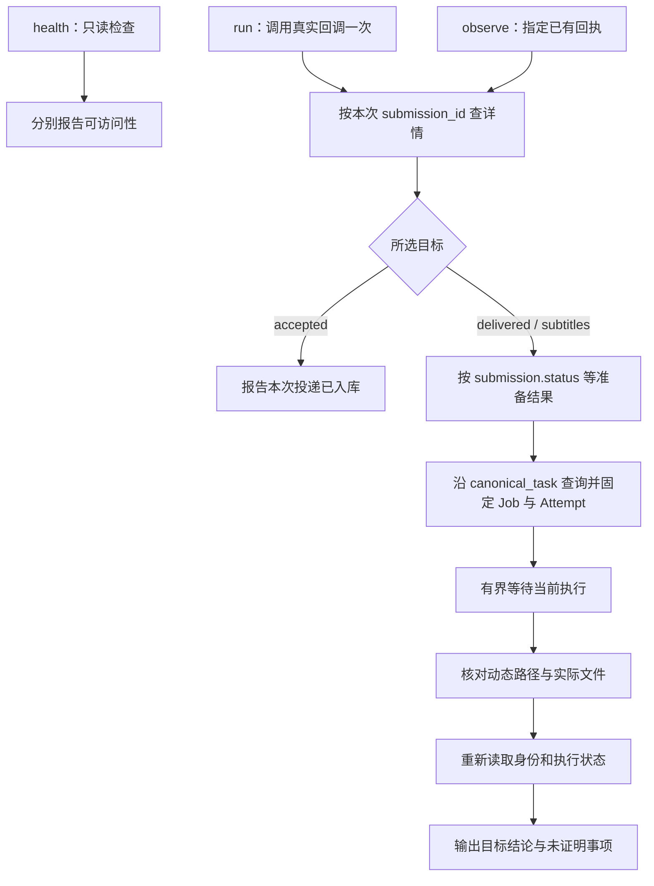

# 教程与测试共用的部署验证方案

状态：**用户已选择“按最小方案实现”；共用命令已实现，真实部署验收尚未执行。**

设计阶段只新增本文；用户确认后承接了资料分支，并实现共用命令、契约测试与教程迁移。未向现网投递媒体、修改或重启现网。第 2、11 节保留设计阶段的来源和检查记录，第 12 节记录后续实现；实际用法见[部署检查命令](../deployment/verification.md)。

## 1. 推荐结论与待确认范围

推荐交付一个 Python 标准库命令 `scripts/verify_deployment.py`。两份教程和 agent 只传入部署参数、选择要验证的目标；自动化测试直接启动同一个命令。回执解析、Submission → Job → Attempt 关联、等待、产物映射和结论生成只实现一次。

首版自动判断三件事：**接口可访问、投递已入库、关联任务的交付产物可读**。产物检查可进一步要求非放行的转录与翻译字幕。它不会把这些结果写成“本次 ASR 与 LLM 已实测成功”。真实模型验收继续调用同一命令取得关联信息与产物证据，再在隔离部署中补充实际服务执行证据。模拟测试不能替代这一步。

这不是降低验收要求，而是把目前 API 能回答的事实与需要外部证据的事实分别写清楚。**若用户要求单个命令直接、自动证明“本次实际调用了 ASR 和 LLM”，首版范围就必须包含服务端执行凭证，不能继续靠客户端猜测。** 第 10 节给出该替代方案的成本。

设计时提交的范围选择（用户已确认第一项）：

- **推荐：先做共用命令，不改 Muse API。** 命令自动核对投递和产物；真实模型与三种硬件的验收另有明确证据要求。保留未实测标记，允许文档与 Linux 适配各自推进。
- **扩展：先补服务端调用凭证，再做自动模型验收。** 增加持久化模型调用与复用原因、Attempt 归属和产物来源的设计及实现；工期和回归面扩大。

Basis：用户选择“教程和测试共用的部署检查命令方案，先确认再决定实现”；最小范围建议为本文 own judgment，依据第 2、3 节的实际证据缺口。

## 2. 输入来源与本轮核实范围

### 2.1 版本与资料

| 输入 | 本轮读取与用途 |
| --- | --- |
| 文档续接任务 [#3](todo:Q_9Em-ISuaJPOicps0g3x) | 读取任务元数据，确认资料仍在独立分支 |
| `tds/conv-01a1b025-53f2-7848-a1d6-23765d197ade` | 本轮 fetch 后头提交为 `64bab27`，前序为 `4ef7d1b`；读取两份教程、Linux 说明、验证报告和部署测试源码 |
| 本设计工作树 `82b4d0d` | 读取真实 handler、queue、processor、HostASR、回调脚本、配置及领域文档；与 `64bab27` 比较，`internal/`、`cmd/`、`Makefile` 无差异 |
| 用户提供的四轮失败模式 | 用于确定必须防止的误报；不重新启动旧补丁审查 |

未合并资料的固定版本入口：[教程与代码树](https://github.com/weizsw/fusionn-muse/tree/64bab27)、[原验证报告](https://github.com/weizsw/fusionn-muse/blob/64bab27/docs/deployment/verification-report.md)、[原部署测试](https://github.com/weizsw/fusionn-muse/blob/64bab27/scripts/test_deployment_verification.py)。设计阶段未复制这些资料；确认后的实现阶段已承接它们。

已从源码核实的前提：

1. 最新两份教程读取关联 Job 的 `job.translated_path`；测试的确通过 `extract_tutorial_bash_script` 提取 Markdown Bash 代码块并执行。不是仅相信原作者报告。
2. 该测试仍使用自建 HTTP 模拟应答、预置文件；它证明的是命令在这些应答下的行为，不是实际 Muse、模型、Docker 或 Linux 部署通过。本轮没有重跑这套旧分支测试，也不给旧补丁审查结论。
3. 原报告中的“首次全链路”“已全部闭环”不作为本文的已证事实；以可重现的证据层级为准。
4. `is_light=true` 不保证 `translated_path` 为空：外挂中文字幕放行时，处理器会把已有字幕复制到最终字幕路径。报告中把放行路径概括为空的前提应以真实代码修正。
5. 设计阶段的工作树没有这些待合并教程；实现阶段已先承接该资料分支，再迁移验证章节，保留其余资料。

### 2.2 代码依据索引

以下链接指向本设计同一版本的代码；上表的差异核对使它们也适用于所读资料分支。

- [领域词汇](../../CONTEXT.md)：Submission、Preparation run、Job、Attempt、Duplicate submission、Artifact claim、Stage checkpoint。
- [ADR 0006](../adr/0006-unify-observation-by-latest-execution.md)：最新执行与保留的 Job 结果分离。
- [ADR 0005](../adr/0005-reserve-job-owned-artifact-paths.md)：路径所有权不是阶段完成或文件存在的证据。
- [HTTP 路由与投递回执](../../internal/handler/handler.go)、[详情与历史参数](../../internal/handler/task.go)。
- [Task 投影](../../internal/queue/task_query.go)、[TaskDetail 与历史](../../internal/queue/task_detail.go)、[Submission 类型](../../internal/queue/submission.go)。
- [提交与准备](../../internal/queue/submission_worker.go)、[重复媒体关联](../../internal/queue/submission_store.go)、[Job/Attempt 字段与媒体身份](../../internal/queue/job.go)。
- [处理与最终交付](../../internal/service/processor/processor.go)、[翻译回执复用](../../internal/service/processor/translation_receipt.go)。
- [HostASR 文件路径协议](../../internal/executor/host_asr.go)、[配置与目录](../../internal/config/config.go)、[媒体大小门槛](../../internal/mediaintake/media.go)。
- 回调以资料分支版本为准：[torrent_complete.py](https://github.com/weizsw/fusionn-muse/blob/64bab27/scripts/torrent_complete.py)。实现阶段已承接其环境变量覆盖修订，并增加可选 JSON 回执。

## 3. 真实 API 能证明什么

### 3.1 身份与状态

| 对象 / 字段 | 实际语义 | 验证命令的用法 |
| --- | --- | --- |
| `POST /api/v1/webhook/torrent` → 202、`submission_id` | 请求与 pending Preparation run 已持久化；后台处理尚可失败 | 只接受本次回执；202 不等于处理成功 |
| `GET /api/v1/tasks/submission/{id}` 中 `submission.status`、`submission.run_id` | 此 Submission 最近一次准备执行 | 判断准备失败、忽略、中断；固定 run ID 防止人工重试换执行 |
| 同一响应顶层 `status`、`execution_id` | resolved 后投影关联 Job 的最新执行，不再只是准备状态 | 不能将它与 `submission.status` 混用 |
| `canonical_task={kind:"job",id:…}` | 此 Submission 关联的 Job | 只沿此关联查询，不搜索番号、名称或“最近任务” |
| `GET /api/v1/tasks/job/{id}` 顶层 `status` | 最新 Attempt 的状态 | `pending` / `processing` 等待；`failed` / `interrupted` 不算成功 |
| `job_status` 与 `job.status` | Job 保留的处理结果 | 重翻译失败后仍可能是 completed；不得覆盖顶层失败 |
| `execution_id`、`execution_kind`、`job.attempt_id` | 当前最新 Attempt | 固定 ID；发生替换就停止本次证明，不能默默改跟新执行 |
| `stage` | 正在执行、失败阶段或完成 checkpoint | `transcribing` / `translating` 是 stage，不是 status；最终通常为 `delivered`，不是 `scraping` |
| `history`、`next_history_cursor` | 分页历史，包括 preparation 和 attempt | 找到目标执行须按 `kind + id` 匹配并分页，不能取 history 第一项 |
| `persistence_error` | 持久化状态存在异常 | 不能报告通过 |

准备状态使用 `submission.status` 的 `pending / preparing / resolved / failed / interrupted / ignored`。顶层状态使用另一组 `pending / processing / completed / failed / interrupted / ignored`。对必需字段缺失、错误类型、未知状态应返回“无法判定”，不能默认 false 或 completed。新增无关字段不必导致失败。

Duplicate submission 只会关联既有 Job，不自动创建新 Attempt。改文件名、换 info hash、换请求 ID、换 Submission ID，都不保证新处理；媒体身份主要按内容抽样签名判定。`job.created_at < submission.created_at` 可以发现一类旧 Job，但反过来不能证明由本次提交创建：并发提交也可能复用其间创建的 Job。当前 API 没有原子返回 `created_job` 或“本次 Submission 创建了哪个 Attempt”的字段。

### 3.2 产物与模型执行

| 观察 | 可以支持的结论 | 不能支持的结论 |
| --- | --- | --- |
| Muse `/health` 返回 200、`{"status":"ok"}` | Muse HTTP handler 可访问 | 数据库可写、ASR 可用、模型已加载 |
| HostASR `/health` 可访问 | 从发起检查的位置能访问服务 | Muse 容器也可访问、模型推理成功 |
| 本次回执查询成功 | 此次投递确已入库 | 准备或后续处理成功 |
| 关联 Attempt completed 且 Job checkpoint delivered | Muse 记录该执行完成交付 | 一定是新执行；ASR、LLM 一定被调用 |
| `job.processing_path` | 普通交付完成后被更新为实际 scraping 视频路径 | 不能拿提交文件名自行拼出最终视频路径 |
| `job.subtitle_path`、`job.translated_path` 的文件可读 | 该 Job 记录的源字幕与最终字幕当前存在 | 文件本次才生成、翻译质量合格、模型本次运行 |
| `is_light=true` | 已有字幕直接放行，不需 ASR/LLM | 不是部署失败；也不一定没有最终字幕文件 |
| `is_light=false` | 未走已有字幕放行标志 | 仍可能 dry-run，或复用旧转录/翻译回执 |
| `transcription_source`、阶段完成日志 | 处理器记录的来源与阶段经过 | 不构成模型调用凭证：已有转录也会设置来源并完成阶段 |

转录步骤会在持久字幕已经存在时直接复用。翻译步骤可复用匹配源字幕的 Attempt 回执；`stage_started` / `stage_completed` 也可能包围复用路径。最终路径不是按 Attempt 不可变的历史版本，后续重翻译可以更新它。文件 mtime、哈希、非空检查都只能补充证据，不能代替执行归属。

真实 ASR 的 `/transcribe` 接收视频路径，返回共享文件系统中的 SRT 路径；不是上传媒体的 OpenAI ASR 接口。因此检查者能访问文件、Muse 能访问文件、ASR 宿主机能访问文件，是三个不同位置的事实。

## 4. 一个小接口承载共用行为

### 4.1 命令提案

选择 Python 标准库，沿用现有回调与 Python unittest 工具链；不新增 jq、Pact、浏览器框架或独立守护服务依赖。首版保留仓库现有 Python 运行要求。

```bash
# 只读：检查 Muse HTTP；不发送 webhook
python3 scripts/verify_deployment.py health \
  --url http://127.0.0.1:4444

# 有副作用：用真实回调提交一个已准备好的测试视频，并核对字幕产物
python3 scripts/verify_deployment.py run \
  --url http://127.0.0.1:4444 \
  --host-root /path/to/isolated-media --container-root /data \
  --sample /path/to/isolated-media/torrents/whisparr/VERIFY-123.mp4 \
  --name VERIFY-123 --category whisparr \
  --expect subtitles --timeout 14400

# 只读：继续观察已知回执，不重新提交
python3 scripts/verify_deployment.py observe \
  --url http://127.0.0.1:4444 \
  --host-root /path/to/isolated-media --container-root /data \
  --submission-id <receipt-id> --expect delivered --timeout 14400
```

`run` / `observe` 的 `--expect` 必填，支持：

| 目标 | 通过条件 | 成功措辞 |
| --- | --- | --- |
| `accepted` | 回执有效，详情中的 Submission 身份匹配 | 本次投递已入库 |
| `delivered` | 关联身份稳定、当前执行完成、交付 checkpoint 与视频文件核对通过；若记录最终字幕路径也核对该文件 | 关联任务的交付产物已核对；注明是否放行 |
| `subtitles` | delivered 条件 + `is_light=false` + 非 dry-run 的执行配置证据 + 源字幕及最终字幕均可读且基本 SRT 结构有效 | 关联任务的转录与翻译字幕产物已核对；实际模型调用仍需外部证据 |

`accepted` 允许随后准备失败，报告必须同时显示此状态；用户要求的只有入库证明。不要为连通性检查默认投递不存在的路径：有副作用的验证需要显式 `run`。`run` 接受存在的样本文件并检查路径；只需观察错误准备记录时用 `observe`。

`delivered` 不要求非放行，适合检查已有中文字幕视频的流转。`subtitles` 遇到放行返回“样本不适用”，不是“部署故障”。首版不提供容易被误读的 `--expect full` 或“一切通过”输出。

`--timeout` 是总观察期限，处理目标必须显式提供；上例四小时仅为演示，不是 CPU/NVIDIA 的耗时承诺。请求超时、轮询间隔可有普通 CLI 参数，供慢机器和测试使用；测试不能通过覆盖 `sleep` 或重写源代码加速。可选 `--asr-url` 健康检查独立列出，不把宿主机连通性当作容器连通性。

Basis：命令结构、目标名称、参数与超时策略为 own judgment；沿用现有标准库回调、只读边界以及按证据分级的需求。

### 4.2 回执只解析一次，不依赖日志

最小配套修改是给交付的 `torrent_complete.py` 增加可选 `--receipt-json` 输出。保留 qBittorrent 的原四个位置参数和默认行为；默认 stdout 仍为空，日志仍写 stderr。

启用该选项时，stdout 恰好一个 JSON 对象，包含 schema 版本、结果、request ID、HTTP 状态与成功时的 Submission ID。它复用当前 `submit` 的 202 校验，不再发第二次请求。分类被忽略时可保持原回调退出 0，但回执必须明确为 `skipped`；验证命令据此不能判投递成功。

验证命令通过子进程调用同仓库版本的真实回调，用同一组环境变量传 URL 和路径映射，解析该 JSON，不用 grep/cut 抽日志，不直接重写一套 webhook POST。对独立安装的回调提供显式 `--hook` 路径，报告实际文件版本或摘要。若回调没有新回执协议，明确不兼容，不回退到日志猜测。

回调仍可独立复制部署，不为这次验证引入通用 SDK 或共享包依赖。实现可以在原文件内部把发送结果整理为结构化返回值，再分别输出日志与 JSON。

### 4.3 输出、退出码与报告

stdout 是一个版本化 JSON 结果；stderr 是简短的人类进度。agent 读取 JSON，不解析中文措辞。用户也可保存 stdout 作为本地验收记录。结果按白名单收集，不保存原始 settings snapshot、模型请求正文、凭据或完整服务日志。

拟议字段：`schema_version`、`expectation`、`outcome`、`reason`、`submission_id`、`preparation_run_id`、`job_id`、`execution_id`、`execution_kind`、当前状态、是否放行、产物路径/大小/摘要、命令与 Muse 版本、开始/结束时间，以及逐项 `claims`。

例如 `claims` 分别包含 `submission_persisted`、`delivery_observed`、`subtitle_artifacts_observed`、`asr_invoked_this_run`、`llm_invoked_this_run`。前三项据证据取 `proven / not_proven / not_applicable`；首版后两项不依据状态推断为 proven。模拟运行由测试/验收报告标明 `environment=simulated`，不据此认证真实服务。

| 退出码 | 含义 | 示例 |
| --- | --- | --- |
| 0 | 所选目标的证据齐全 | 字幕产物核对通过，不代表真实模型验收通过 |
| 1 | 已观察到目标失败 | 准备 failed、Attempt interrupted、稳定完成后文件缺失或为空 |
| 2 | 无法完成证明 / 参数或环境不适用 | 超时、响应不兼容、执行被替换、HTTP 不可达、放行样本要求字幕处理、缺配置证据 |

每个非零结果附稳定的 `reason`，区分超时、错误样本、旧任务、路径无法映射、真实服务失败等；不能把它们合并成一个“安装失败”。POST 回执丢失属于结果未知，**不得自动重发**；保存 request ID，供操作者查找回执后用 observe 继续。用户中断也不触发队列取消、恢复或重试。

Basis：退出码和结果结构为 own judgment；不扩大实际证据的含义，延续回调单次 POST 行为。

## 5. 共用状态机与证据约束



### 5.1 请求与准备

1. 检查参数和路径映射；health 不访问媒体。run 的样本检查失败发生在 POST 之前。
2. run 调用回调一次，要求成功回执；observe 使用提供的 ID。响应必须是预期 JSON 对象，身份与 URL 一致。限制单次请求时间和响应大小，拒绝重定向，不跨服务猜测结果。
3. 详情中顶层 `kind/id` 与嵌套 `submission.id` 必须匹配。固定 `submission.run_id`；缺失或变化返回无法判定。accepted 到此可结束，附带实际准备状态。
4. 处理目标下，`submission.status` 为 pending/preparing 时等待；failed/ignored/interrupted 返回未满足目标。resolved 必须有合法 `canonical_task.kind=job` 与非空 ID，且匹配 `submission.job_id`。字段矛盾返回不兼容，不使用顶层失败错误冒充准备失败。

### 5.2 Job、Attempt 与当前执行

1. 查询关联 Job，核对顶层 `kind/id`、`job.id` 与 canonical ID；要求正整数 execution ID，且匹配 `job.attempt_id` 和对应历史项。
2. 首版处理目标只接受可识别的 initial Attempt。旧 Job（创建时间早于该 Submission）、恢复/重翻译/自动重试，或存在与本次无法消歧的其他准备关联时返回无法证明本次样本处理，保留实际状态与原因。不能自动清库、删除历史文件或触发恢复。
3. `history_cursor` 跟随 `next_history_cursor`，在总期限与有界页数内找到目标 preparation 和 attempt、所需配置证据；超过范围或找不到返回证据不足。解析 settings snapshot 时使用实际 JSON Go 字段名，例如 `DryRun`，不是 YAML 的 `dry_run`；不把空快照按当前配置补齐。
4. 固定 Job ID、Preparation run ID 和 Attempt ID。pending/processing 等待；completed 再验产物；failed/interrupted 返回目标失败。若自动重试已创建新 Attempt，即使它后来成功，首版也返回执行已变化，而不是把两次执行拼成一次证明。这是首版的有意限制，不是宣称 Muse 自动重试有错。
5. 终态要求顶层 status、`job.attempt_status`、`job_status`、`job.status` 一致支持完成，checkpoint 为 delivered，且无 persistence error。不能用嵌套 completed 遮盖最新执行失败。
6. 在文件读取完成后再次读取 Submission 与 Job；关联、run ID、Attempt ID、相关路径和终态不变才返回通过。发生变化返回无法判定。这个做法减少竞争窗口，并不提供文件系统事务或永久不变保证；结果只表述检查时观察到的事实。

以上排除规则能挡住已知旧执行，但不能从当前 API 构造不存在的“本次新调用”保证。完成得太快、一次轮询没见到 transcribing/translating 不是失败；反过来轮询见到它们也不是实际模型调用证据。

Basis：身份与状态规则依据第 3 节代码；首版拒绝执行切换、历史不足时保守退出为 own judgment，避免引入多 Attempt 证据合并框架。

### 5.3 路径、文件与放行

- 视频从 `job.processing_path` 读取；源字幕从 `job.subtitle_path`；最终字幕从 `job.translated_path`。不推断番号、扩展名、语言后缀或配置中的固定字幕名称。
- 服务端路径必须是容器根下的绝对 POSIX 路径，并落入相应交付目录；按路径段映射到本地根，不能字符串删除 `/data` 后盲拼。例如 `/database/x` 不属于 `/data`。拒绝 `..` 越界和解析后逃出允许根目录的符号链接。
- 检查普通文件、可读和非空。subtitles 额外验证源/目标 SRT 至少有有效时间轴与非空字幕条目；字幕文件摘要用于记录与后续比对，不作为“新生成”的证明。视频只记大小与路径，首版不为大视频强制做完整哈希。
- 放行按 `is_light` 与 `subtitle_detection_reason` 解释；外挂字幕复制也属于放行。布尔值必须实际存在且类型正确，不能 `// false` 补出非放行。
- subtitles 必须取得对应 Attempt 的有效配置快照并确认 `DryRun=false`；来源与路径必须存在。即便这些都通过，真实模型调用依然为未证明。
- 检查命令需在可以读取宿主机映射目录的位置运行。纯远程 HTTP 能验状态，不能验文件；无法读取映射返回无法判定，不能悄悄降级成功。
- 独立验收目录不接入 mdc-ng 自动搬运。现网文件可能已被下游移走，此时只能报告当前产物缺失/无法核对，不能推定 Muse 没有交付，也不能擅自暂停现网消费者。

Basis：动态路径来自 processor；映射与检查约束为 own judgment，针对残留文件、名称变化与下游搬运造成的错误结论。

## 6. 测试怎么真正覆盖交付命令

采用三个互补层次，报告分别列结果，不合并叫“全链路通过”。

| 层次 | 测试方式 | 可以证明 | 不能证明 |
| --- | --- | --- | --- |
| 命令行为 | Python unittest 启动真实 CLI 和真实回调，临时 HTTP 服务、临时文件、独立端口；断言请求记录、JSON 与退出码 | 回执处理、状态机、路径映射、误报防护、超时 | API 模拟本身正确、真实媒体有效、模型可用 |
| 真实 API 契约 | Go 测试启动真实 Gin handler + queue + 临时 SQLite；在已有 processor/preparer seam 下使用确定性替身，并启动同一个 Python CLI | 真正序列化字段、关联/重复提交、最新 Attempt 与保留结果语义兼容客户端 | 替身之外的媒体工具、模型或硬件可用 |
| 部署验收 | 独立真实部署、有效视频、真实 ASR/LLM、同一 CLI + 执行证据 | 该版本、该配置、该平台的实际流程 | 所有硬件、性能容量或字幕语义质量普遍合格 |

真实 API 契约测试应复用现有 `internal/handler/submission_test.go`、`task_test.go` 的临时队列和 HTTP 测试模式。替换发生在真实请求解析之后，不能手写一份假的 TaskDetail 响应来“验证”自己手写的模拟。小规模确定性 processor 替身可以写 fixture 产物，但报告必须声明它是替身。processor 现有测试继续负责业务逻辑，不为验证工具建立另一套队列实现。

模板应答只用于错误注入与边界组合。测试不复制生产判断函数来计算期望值，而是断言可观察结果和副作用：POST 次数、GET 的精确 ID、没有访问历史番号、没有发 actions、失败没有生成成功结论。

### 6.1 必须覆盖的行为矩阵

| 场景 | 所选目标与期望 |
| --- | --- |
| 回调分类跳过但退出 0；202 缺 ID；stdout 混入日志；非 JSON | accepted 不通过；不能仅看退出码 |
| POST 超时、重定向、非 202；GET 404/5xx | 分类说明失败/未知；POST 恰好一次，不自动重投 |
| 本次准备失败、ignored、中断、长期未关联，同时存在旧 completed Job | 处理目标不通过，绝不按固定番号或旧 ID 查询 |
| resolved 后顶层是 Job 状态，但嵌套准备为 resolved | 正确区分准备与执行，不混用两组状态 |
| Submission / canonical / Job / Attempt ID 不一致；状态类型错误或缺字段 | 无法判定，不用空值默认成功 |
| Duplicate submission 指向旧 completed Job，字幕视频均在 | 不证明本次处理；真实 API 层也覆盖重复关联 |
| Job 保留 completed，最新 retranslation failed | 不通过，不能读保留结果误报 |
| 自动重试、人工恢复或 Preparation run 在观察中变化 | 返回执行变化，保留 IDs，不调用恢复动作 |
| 完成快于轮询间隔，从未看到中间阶段 | 允许按终态与产物核对；不虚构中间阶段 |
| light，无最终字幕；light，复制 sidecar 后有最终字幕；均有旧字幕残留 | delivered 可通过；subtitles 样本不适用，ASR/LLM 不得 proven |
| 非 light，但 dry-run 或缺可读快照 | subtitles 不通过；不能以非 light 代替配置证据 |
| 动态文件名与输入不同，动态路径存在，固定路径也有旧文件 | 只验动态路径；删动态文件后必须失败 |
| 动态字幕缺失、空文件、SRT 结构无效，视频仍在 | subtitles 不通过 |
| `/database` 伪前缀、目录穿越、根外符号链接、空格/中文路径 | 越界拒绝；合法特殊字符不经 shell 拼接误解释 |
| 文件核对期间出现新 Attempt/新路径；下游移走视频 | 不返回稳定通过 |
| 历史分页后才有目标执行；找不到或达到上限 | 正确分页或明确证据不足，不默认取第一项 |
| 首版所有模拟成功路径 | 模型调用 claims 保持 not_proven |

### 6.2 文档共用的具体方式

两份教程只保留同一 CLI 的短调用示例，差别限于 URL、路径和目标；Linux 教程未来也调用同一入口。agent 说明只定义何时选目标、如何报告结果，不再内嵌另一套 curl/jq 状态机。

文档测试只需解析或提取标记的短示例，通过预先约定的环境变量提供临时参数，真实运行入口并检查参数合法性。不做标题正则截取一串长 Bash，再全局替换端口/目录/睡眠函数。完整失败矩阵归属于命令测试，不能在每份教程各复制一套。

当新命令和真实 API 契约测试通过后，替换旧 `scripts/test_deployment_verification.py` 中的长教程脚本测试；保留其有价值的失败场景。旧文件的版本仍留在 git 历史。迁移过程中不在两处同时维护同一行为逻辑。

Basis：测试接口遵循 codebase-design 的“Interface is the test surface”；契约校验与隔离依据第 9 节，具体测试组织为 own judgment。

## 7. 真实服务、三种平台与下游的验收边界

### 7.1 真实样本验收流程

这部分是确认后实施与实测的要求，本轮未执行。

1. 在用户授权的独立部署中使用新的数据库、工作目录、转录目录、翻译缓存和独立端口；模型权重缓存可以共享，字幕/翻译结果缓存不共享。记录初始环境证据，不清理或重置现网。空目录和新数据库由部署准备步骤建立，验证命令不负责建机、装模型、改 Compose 或删文件。
2. 使用有权处理的真实视频，标准可识别名称、有效音轨、满足实际媒体过滤规则。当前代码最低大小为 `200 * 1024 * 1024` 字节；大小合格不等于媒体有效，不能用填充字节文件冒充 ASR 样本。测试集至少包含一段无中文字幕的有声视频，以及一个明确的已有中文字幕放行样本。样本与版权材料不自动提交到公共仓库。
3. 明确 `DryRun=false`、实际模型和 provider、路径映射、版本/镜像摘要、操作系统和硬件；运行同一个 run 命令，保留 Submission、Preparation run、Job、Attempt ID 与产物核对结果。新目录/单提交也减少重复关联与并发歧义。
4. 对无字幕样本，核对同 Job/Attempt 的 HostASR 接收及完成记录、推理进程执行结果，以及 LLM 实际请求/响应成功的证据。仅有 processor 阶段日志或翻译子进程启动不足以排除缓存。现有 HostASR 请求携带 job_id/attempt_id，可用于关联；若部署副本或 provider 日志无法提供足够归属证据，该项保持“未证明”，不能推测通过。日志只保留脱敏的关联、时间、模型、成功摘要。
5. 查看最终视频与两份字幕，人工抽样确认内容、时间轴和翻译方向；CLI 的 SRT 结构检查不判断翻译准确性。放行样本应证明交付与跳过行为，不计入 ASR/LLM 通过数。
6. 报告分列“共用命令结果”“真实模型证据”“人工内容抽样”，缺哪项就写哪项未验证。外部验收结论不回写成 CLI 自动证明，也不允许操作者加一个 `--trust-me` 开关把未知改为通过。

Basis：新环境优先于清理的隔离实践见第 9 节；样本与模型证据要求基于 processor 复用行为、HostASR 协议和用户要求真实验证的范围。

### 7.2 平台与网络视角

| 环境 | 可先做的工作 | 必须留给真实环境的证据 |
| --- | --- | --- |
| 无模型开发机 / CI | 命令矩阵、真实 handler/SQLite 契约、路径规则 | 模型推理、音轨解码、部署挂载、真实 provider 调用 |
| macOS Apple Silicon | 同一命令，HostASR 专有文件路径协议 | 容器到宿主机访问、实际 MLX 模型、实际 LLM、共享 SRT 路径 |
| Linux NVIDIA | 沿用同一命令契约，等待 Linux ASR 实现 | 实际 NVIDIA 设备与驱动、GPU 推理、容器可见性及文件共享；不能用 CPU 成功代替 GPU 验收 |
| Linux 纯 CPU | 沿用同一命令契约，等待 Linux ASR 实现 | 实际 CPU 推理、内存和耗时、模型兼容、共享文件；不能用 macOS 测试替代 |

本轮没有启动 Linux，也不认可资料中“完全原生支持”的表格等同于本轮实测。Linux 两类运行时仍是独立实现范围；命令不引入 MLX 固定健康标记或固定时限，以免验证接口再次随硬件重写。

### 7.3 qBittorrent 与下游

直接调用真实回调证明脚本可投递，但不证明 qBittorrent GUI 中已正确设置 `%N %L %I %F`。正式联动验收还需要一次实际下载完成事件及它产生的回执，随后可用 observe 读取同一回执。

Muse 的自动交付检查止于 scraping 视频与字幕目录。mdc-ng 消费、整理到 finished、115strm 生成 `.strm`、Emby 入库/播放应按同一媒体逐站记录证据；本命令不登录这些服务，也不宣称 Muse completed 就代表它们成功。先在没有下游抢走产物的独立目录验 Muse，再做完整联动，不能为了测试停掉现网监听。

## 8. 实际改动与依赖关系

用户已确认最小方案的实现（下表 1–5）；真实部署验收与 Linux 实现仍按下表各自的前提推进，本次不改动现网。

| 次序 | 交付位置 | 实际工作与完成条件 | 依赖 |
| --- | --- | --- | --- |
| 1 | 工作基线与现有资料 | 承接资料分支的 README、教程、配置、脚本；核对核心 API 是否仍与本文一致，保留原报告为历史记录 | 用户确认；资料分支可读 |
| 2 | `scripts/torrent_complete.py` 及其测试 | 增加可选 JSON 回执，维持 qBittorrent 默认调用兼容；覆盖 skipped、一次 POST、错误应答 | 1 |
| 3 | `scripts/verify_deployment.py`、部署验证测试 | 实现单一命令、结果结构、状态机、动态产物映射；错误注入测试直接执行入口 | 2 |
| 4 | `internal/handler/*_test.go` | 用真实 API/SQLite 驱动同一命令，覆盖关联、重复与当前执行；无需修改生产 handler | 3，可与矩阵完善并行 |
| 5 | 两份教程、README、Linux 说明、原验证报告 | 验证章节改为薄调用；分级说明与真实结果一致；替换旧长代码块测试，历史结论明确标为旧报告 | 3、4通过 |
| 6 | 隔离部署验收记录 | macOS 真样本、真实 qBittorrent 和下游各记证据；未测项明确保留，不自动公开日志 | 5 + 用户授权的环境、有效样本与模型访问 |
| 7 | Linux NVIDIA / CPU 支持及各自实测 | 在文档交付按原流程合并后推进 Linux 运行时；沿用命令与证据格式，分别验收 | 文档交付合并 + Linux 实现 + 对应机器 |

不增加生产数据库迁移、通用部署框架、自动恢复功能或第二套任务查询接口。若实施时发现当前契约不足以支持选定目标，应回到第 10 节选择，而不是在教程里补特殊分支。

结束反复修补的条件是：逻辑集中到命令、真实 API 契约验证通过、历史误报场景在命令入口受测、教程只负责参数和解释、真实实测缺口如实列出。缺少某台 Linux 机器不应被写成通过，也不应使两份教程继续各自增加 Bash 判断。

Basis：改动次序来自用户“保留资料、先设计确认”及原文档后 Linux 的依赖；具体拆分为 own judgment。

## 9. 成熟实践与采用方式

这些实践提供原则，不要求本项目安装所引用产品。

| 实践与一手来源 | 本方案采用的部分 | 没有据此声称的能力 |
| --- | --- | --- |
| Docker：[Control startup order](https://docs.docker.com/compose/how-tos/startup-order/)；本轮读取其[官方 Markdown](https://github.com/docker/docs/blob/main/content/manuals/compose/how-tos/startup-order.md) | 容器 running 不等于 ready，ready 也只由具体 healthcheck 定义；单列连通性与业务验收 | healthcheck 不证明模型调用 |
| Pact：[Writing Consumer tests](https://docs.pact.io/consumer) 与 [Verifying Pacts](https://docs.pact.io/provider)；本轮读取[consumer 源文](https://github.com/pact-foundation/docs.pact.io/blob/master/website/docs/consumer.md)、[provider 源文](https://github.com/pact-foundation/docs.pact.io/blob/master/website/docs/provider.md) | 消费者如何理解应答必须由本地真实 provider 校验；只替换请求解析之后的外部依赖；契约测试和业务功能测试分开 | 自写 mock 返回期望字段不能证明真实 API；本项目无需引入 Pact Broker |
| Playwright：[Isolation](https://playwright.dev/docs/browser-contexts)；本轮读取[官方源文](https://github.com/microsoft/playwright/blob/main/docs/src/browser-contexts.md) | 每次从干净隔离环境开始比“清掉上次痕迹”可靠；这里映射到数据库、目录、端口和缓存隔离 | 浏览器隔离实践本身不验证 Muse 媒体或模型 |

小接口承载复杂判断、调用者和测试跨同一个接口，是本轮使用的 codebase-design 方法。实际依赖 seam 只保留已经变化的对象：真实 HTTP 与故障注入服务、真实文件与临时文件、真实 processor 依赖与测试替身。无需为了“可扩展”新增插件层。

## 10. 替代方案及确认影响

| 方案 | 优点 | 成本与取舍 | 建议 |
| --- | --- | --- | --- |
| 继续两份 Bash 并提取 Markdown 测试 | 眼前变动最少 | 回执、状态机与路径逻辑仍重复；模拟契约仍可自证；是用户已暂停的路线 | 不继续 |
| 共用 Python 命令 + 真实 API 契约 + 单列模型实测 | 重用现有脚本工具链；不改生产 API/数据库；集中修复误报 | 单个命令不能自动认证本次模型调用；真实验收需补证据 | 推荐首版 |
| 共用命令 + 服务端持久化执行凭证 | 可机器判定 fresh/reused、哪个 Attempt 实际调用了哪个服务 | 需设计提交到 Attempt 的来源关联、调用结果、缓存/跳过原因、产物归属，处理失败/恢复/重翻译与旧数据；仍需真硬件验收 | 仅在用户要求自动模型证明时选择 |
| 全套部署/模型/下游自动编排框架 | 能统一搭建大范围环境 | 扩张到权限、凭据、安装和清理；本任务目标不需要 | 暂不采用 |

扩展方案的最低证据不是给响应加一个 `asr_done=true`：它需要在真实调用 seam 记录调用/复用/跳过及成功结果，绑定 Job/Attempt 与输入/输出来源，并通过恢复路径持久化；旧记录缺证据必须为 unknown。它也只能证明所配服务被调用，服务是否实际使用 GPU、模型是否正确仍需服务与硬件证据。本文不提前设计迁移表或执行该方案。

除了这一范围选择，命令语言、短示例组织、退出码及保守处理重试的规则可按本提案实现，不必逐项再次征询偏好。真实样本、硬件与授权在对应验收阶段才需要，当前设计不以这些条件为阻塞。

## 11. 本轮验证记录

本轮仅做源代码、未合并资料与一手实践核实，未对旧补丁进行新的独立审查，未执行本文拟议命令，未声称部署或模型实测通过。

检查结果：

- `make lint`：通过，`0 issues`。
- `make test`：首次使用系统 Python 时，Go 测试通过，Python 因缺少 `pydantic` 导入失败。随后仅在 `/tmp/muse-deployment-design-venv` 创建临时虚拟环境并安装 Pydantic 2.14.3；以 `PATH="/tmp/muse-deployment-design-venv/bin:$PATH" make test` 重跑，Go race 测试全部通过，Python 共运行 132 项、跳过 11 项，最终为 `OK (skipped=11)`。跳过项需要 Docker 镜像环境，不计为实测通过。未修改仓库依赖声明或现网 Python 环境。
- 本地 Markdown 链接、代码围栏配对和 `git diff --check`：通过。

这些结果属于设计阶段，不代表当时尚未实现的命令已通过测试，也不包含资料分支独有的旧部署测试。

## 12. 已确认的最小方案实现记录

用户随后选择“按最小方案实现（推荐）”，替代原先仅交设计的限制。实现保持不修改 Muse 生产 API、数据库和现网的范围。

- 从 `64bab27` 承接既有 README、部署教程、配置与脚本；安装资料保留，原验证报告标记为历史记录。没有重做整套开源资料。
- `scripts/torrent_complete.py` 增加可选首参数 `--receipt-json`，原四个位置参数、默认空 stdout 与 stderr 日志保持兼容。支持调用方提供 request ID 和请求超时，以便 POST 结果未知时仍可定位，不自动重发。
- `scripts/verify_deployment.py` 实现 health/run/observe 与 accepted/delivered/subtitles。严格跟踪准备执行、关联 Job 和初次 Attempt，校验动态产物路径与 SRT，并回读执行状态。实际模型调用 claims 始终为 `not_proven`。
- 首版落实了文中的保守限制：旧 Job、多个关联准备记录、非初次 Attempt、执行变化、无足够历史或配置证据均不能判定本次样本处理通过。人工恢复与自动重试不由检查器执行。
- `scripts/test_deployment_verification.py` 改为直接运行交付 CLI/回调的故障矩阵，教程测试只提取标记的短调用并传环境参数。旧长 Bash 状态机已移除。
- `internal/handler/deployment_test.go` 使用真实 Gin handler、queue、临时 SQLite 与同一 Python CLI；仅媒体准备和处理使用确定性替身。覆盖正常产物、外挂字幕放行、重复关联、准备失败，以及 Job 保留 completed 而最新重翻译 failed。
- macOS、agent 与 Linux 说明调用同一入口，公共参数和证据边界集中于 `docs/deployment/verification.md`。

实现验证：`make lint` 通过（0 issues）；`PATH="/tmp/muse-deployment-design-venv/bin:$PATH" make test` 通过，Go race 测试全部通过，Python 共运行 162 项，最终 `OK (skipped=11)`。其中包含 26 个共用命令测试方法（多项故障用 subTest 展开）与三份教程短示例的实际执行；11 个跳过项依赖 Docker 镜像环境，不计为部署实测通过。测试使用设计阶段创建的临时 Python 虚拟环境，以满足既有 HostASR 测试需要的 Pydantic；新检查命令本身仅用标准库。

未执行真实模型、macOS 运行部署、Linux NVIDIA/CPU、qBittorrent 自动事件或下游联动验收。测试使用的媒体和产物是 fixture，不能作为这些项目通过的证据。
