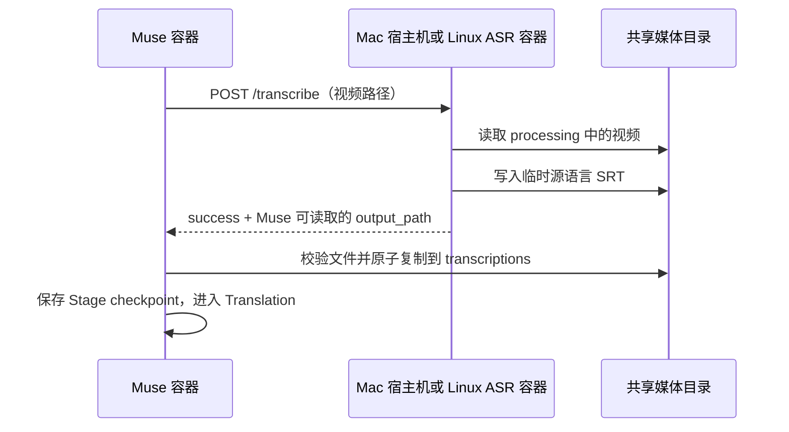

# Linux 转录方案调查与跨平台适配建议

> 调查日期：2026-11-06。本文是后续实现的输入，不代表 Linux 已获支持。
> 范围：只读检查 Muse、本机部署资料及上游一手资料；不启动转录、不下载模型、不修改或重启现有部署。本次仓库改动仅为本文。
> 仓库基线：`82b4d0ddefa2afb00c1ea788fcb92bde38074a82`。本机是 macOS arm64；本任务没有可用的 Linux/NVIDIA 实测环境。上游分支文档可能变化，实施时需重新核实并固定版本。

## 1. 建议与适用范围

**建议保留 Mac 的宿主机 MLX 工作流，Linux NVIDIA 首先接入官方 Qwen3-ASR Transformers 后端和 ForcedAligner；Linux CPU 另评估 faster-whisper。Muse 继续通过同一个窄 HTTP 接口取得源语言 SRT，由现有流程持久化、翻译和恢复。** [R1][R2][Q1][Q2][W1]

Basis：用户明确希望同时支持 macOS、Linux；减少部署及维护负担是本调查的取舍目标，属于调查者判断。仓库已经将转录隔离在 HTTP 服务之后。这不是用户已经选定的硬件支持承诺。

| 用户环境 | 建议路线 | 当前证据和边界 |
| --- | --- | --- |
| Apple Silicon macOS | 保留宿主机 `mlx-qwen3-asr`，Muse 继续在容器内运行 | 用户已有此工作流；检查了磁盘配置和安装源码，本次没有重新做真实转录 [L1][M1] |
| Linux x86-64 + NVIDIA | 独立 ASR 容器：官方 `qwen-asr` Transformers + `Qwen3-ForcedAligner-0.6B` | 官方有 CUDA 示例及长音频分块、时间戳接口；Muse 适配器与可复现镜像尚待实现、实测 [Q1][Q2] |
| Linux x86-64 CPU | 可选独立 ASR 容器：faster-whisper CPU INT8，先评估多语言 `small` | 上游明确支持 CPU INT8，可直接取得分段时间；速度、日语质量尚未在 Muse 样本上比较 [W1] |
| Linux CPU 且必须保留 Qwen | 官方 Transformers，优先试 0.6B、CPU FP32、小批次 | 源码允许传设备和 dtype，但查到的官方示例以 CUDA 为主；仅列实验路线，不承诺长片可用性 [Q2] |
| 更高吞吐 NVIDIA 服务 | 再考虑官方 vLLM 后端 | Muse 当前一次只做一个 Transcription，先引入 vLLM 会增加版本、显存和服务维护成本 [R7][Q1][Q3] |
| Linux ARM64、Jetson、AMD/Intel GPU、Intel Mac | 分开定义后续支持范围 | 镜像架构、CPU wheel、GPU 加速是不同能力；没有硬件验证前不纳入首批支持声明 [R5][W2][W3] |

**Linux 不必继续在宿主机安装 MLX，也不必因此放弃 Qwen 模型。** 需要更换的是推理实现与部署方式；模型、时间轴处理、Muse 的文件协议分别需要核对。旧 `videocaptioner`/Whisper 路径已明确拒绝执行，保留的 `whisper.*` 配置只是历史快照数据；新 CPU 后端应是独立适配，不能把旧路径重新命名为“已支持 Linux”。[R2][R3][R6]

## 2. Muse 与现有 MLX 的实际接口

### 2.1 请求、响应和文件流

Go 的 `HostASR.Transcribe(ctx, videoPath)` 向 `<server_url>/transcribe` 发送 JSON；既不上传视频字节，也不调用 OpenAI `/v1/audio/transcriptions`。示意请求如下，路径和编号均为示例：[R1]

```json
{
  "video_path": "/data/automation/processing/example.mp4",
  "container_prefix": "/data",
  "host_prefix": "/Volumes/External",
  "model": "Qwen/Qwen3-ASR-1.7B",
  "language": "ja",
  "job_id": "example-job",
  "attempt": 1,
  "attempt_id": 42
}
```

`video_path`、`host_prefix` 是 Python 请求模型的必填项，`container_prefix` 默认 `/data`；模型、语言和关联字段可省略。`attempt` 表示重试序号，`attempt_id` 才是持久化执行编号；Go 使用 `omitempty`，零值字段可能省略。服务端的 `HOST_MEDIA_PATH` 环境变量优先于请求的 `host_prefix`。[R1]



当前仓库的宿主机服务执行（本机另一份脚本的差异见第 2.4 节）：

```text
mlx-qwen3-asr <映射后的视频路径> -f srt -o <视频所在目录> --quiet
```

模型和语言存在时追加 `--model`、`--language`。结束后寻找同目录下“文件 stem 以视频 stem 开头、修改时间不早于开始前一秒”的 SRT，选择最新者；再将路径映射回容器路径。[R1]

```json
{"success": true, "output_path": "/data/automation/processing/example.srt", "error": null}
```

服务在占用、文件不存在、执行失败时分别设置 409、404、500，并返回 `success:false` 和 `error`；Pydantic 请求校验还可能产生 422。Go 要求 HTTP 2xx、`success:true`、非空 `output_path`，然后由 processor 验证这个路径确实是可读的非空普通文件。该验证**不解析 SRT 时间轴或字幕内容**。[R1][R2]

processor 将结果原子复制为 `/data/automation/transcriptions/<视频基名>.srt`，清理不同路径的临时产物，保存 `transcribed` checkpoint。后续 Translation retry、Resume 和 Retranslation 依赖这个持久化文件；不能因切换转录后端就重做已经完成的 Transcription。路径归属还受 Job 的 Artifact claim 保护。[R2][R4]

### 2.2 路径映射的含义

本机部署配置把 `/Volumes/External` 挂到 Muse 的 `/data`，`host_prefix` 与之对应。实际转录输入已经位于 `/data/automation/processing`，所以仅共享只读下载目录是不够的；ASR 必须看见处理目录，Muse 也必须能读取、清理 ASR 返回的字幕。[L1][R2][R3]

| 部署方式 | Muse 所见 | ASR 所见 | 如何复用协议 |
| --- | --- | --- | --- |
| 现有 Mac | `/data/automation/processing/example.mp4` | `/Volumes/External/automation/processing/example.mp4` | `/data` 与宿主机媒体根目录互相映射 |
| 建议 Linux 同机双容器 | `/data/automation/processing/example.mp4` | 同一个 `/data/automation/processing/example.mp4` | 两个容器挂载同一宿主目录到相同容器路径；现有协议下可令两个 prefix 都为 `/data` |
| ASR 在另一台机器 | Muse 的容器路径 | 对方磁盘未必存在此文件 | 当前协议需要额外共享存储及一致映射；仅改 URL 不足以远程转录 |

Linux 同机部署可将宿主机 `/srv/media/automation/processing` 同时挂到两边的 `/data/automation/processing`，并只给需要的目录写权限。ASR 模型缓存独立持久化，不需要读取 Muse 的 SQLite 或翻译凭据。以上是部署建议，当前仓库没有这套 Linux Compose。[R1][R3]

Basis：采用相同路径可省掉 Linux 宿主机路径转换；保留 Go 的文件复制和归属检查可继续遵守现有 ADR。[R4]

### 2.3 哪些与 Apple 有关，哪些可以复用

| 部分 | 判断 |
| --- | --- |
| `mlx-qwen3-asr` CLI、原生 MLX aligner、Metal 优化 | 该 ASR 项目公开要求 Apple Silicon Mac/Metal；不能当作已经验证的 Linux 服务 [M1] |
| Qwen3-ASR 权重和 Qwen3-ForcedAligner 权重 | 官方同时有 PyTorch/Transformers 和 vLLM 用法，不局限于 Mac [Q1] |
| Go HTTP 客户端、SRT 文件交接、持久化和翻译 | 不依赖 Apple；主要耦合是 `MLXQwen3ASRConfig` 和 provider 名称 [R1][R2][R3] |
| FastAPI 包装服务 | HTTP/Python 部分可以复用；执行命令、模型加载、取消和输出发现方式需调整 [R1] |
| `/Volumes/External`、宿主机 URL | 是本机部署选择，不应成为 Linux 默认值 [L1] |
| `host.docker.internal` | Docker Desktop 自动解析；普通 Linux Engine 上的宿主机访问可显式用 `host-gateway`。同 Compose 网络中的 ASR 则用服务名，如 `http://asr:8766` [D1] |

需要纠正一个容易过时的说法：**MLX 框架本身已有 Linux CUDA 和 CPU 安装入口**，官方 README 写有 `mlx[cuda]`、`mlx[cpu]`。但这不能证明 `moona3k/mlx-qwen3-asr` 及其 Metal 相关实现已支持 Linux；其当前要求仍是 Apple Silicon/Metal。结论应针对这个 ASR 实现，不能笼统写“MLX 永远只能在 Apple 上运行”。[M1][M2]

### 2.4 本机资料与仓库的差异

以下事实来自读取磁盘上的部署资料，不代表核实了正在运行进程的解释器、环境变量或镜像摘要：[L1]

- 部署配置选用 `Qwen/Qwen3-ASR-1.7B`、`language: ja`、HTTP 超时 180 分钟；安装包元数据为 `mlx-qwen3-asr 0.4.0`。调查时上游 `main` 的包版本已为 0.4.4，不能把最新文档行为全部回套到本机版本。[L1][M1]
- 本机 `service.py` 使用同步 handler、流式收集日志、进程组管理；默认进程期限为 3600 秒，可由 `ASR_TIMEOUT_SECONDS` 调整，超时返回 504。仓库 `host_asr_server.py` 则使用 `async def` 中的阻塞 `subprocess.run(capture_output=True)`，没有 subprocess timeout，并带有日志关联字段。不能把两份脚本视为同一个受控发布版本。[L1][R1]
- 本机 CLI 的 `-f srt` 会自动启用时间戳并加载 `Qwen/Qwen3-ForcedAligner-0.6B`；不是仅有识别文本即可生成当前字幕。`writers.py` 还会恢复标点、把词/字符时间段组合为字幕条目；仅换官方 ASR 推理调用不会自动复现这些规则。[L1][M1]
- 部署 Compose 的 `/app/models` 挂载指向 Muse 容器，不能据此推断宿主机 MLX 模型缓存已持久化到那里。[L1]

## 3. Linux 候选方案与一手证据

### 3.1 官方 Qwen：优先评估 `qwen-asr` Transformers 后端

官方 `qwen-asr` 包提供 `Qwen3ASRModel.from_pretrained(...)`；其 `**kwargs` 传给 Transformers 模型加载，`forced_aligner_kwargs` 单独配置对齐模型。需要同时加载 ASR 和 ForcedAligner，再调用 `transcribe(..., return_time_stamps=True)`。结果包含 `language`、`text`、`time_stamps`，**不是 Muse 所需的 SRT 文件或 `output_path`**。[Q1][Q2]

| 项目 | 核实结果与适配影响 |
| --- | --- |
| 模型 | 1.7B、0.6B 两种 ASR；对齐模型为 0.6B。先以 1.7B 对照现有 Mac，显存或延迟不合适时再评估 0.6B，不能未经比较宣称质量等价 [Q1] |
| NVIDIA 运行 | 官方示例使用 `device_map="cuda:0"`、`torch.bfloat16`。需匹配 GPU、PyTorch、CUDA、驱动和 dtype；FlashAttention 是可选优化，首版不必为了它增加源码编译步骤 [Q1] |
| CPU 运行 | 加载接口允许显式 `device_map="cpu"`、`dtype=torch.float32`，对齐模型也需相同配置；这是源码支持的尝试方式，未找到能证明 Muse 长片 CPU 性能的官方测试 [Q2] |
| Python 和依赖 | 读取的 `pyproject.toml` 为 `qwen-asr 0.0.6`，声明 Python ≥3.9、`transformers==4.57.6`、`accelerate==1.12.0`，并包含日/韩分词、Gradio、Flask 等依赖；README 建议独立 Python 3.12 环境。它并非只有一个轻量推理依赖 [Q3] |
| 长音频 | wrapper 会先标准化为 16 kHz 单声道音频，再按低能量边界切分；启用时间戳时分块目标为 180 秒，纯 ASR 为 1200 秒，边界搜索有偏移；对齐结果加回原时间偏移。不要将这些目标时长写成精确硬上限 [Q2] |
| 生成预算 | wrapper 默认 `max_new_tokens=512`，README 短音频示例用 256，并提示长输入增大预算。180 秒分块不保证文本能在此预算内完整生成；需检测生成是否截断，避免部分字幕被当作完整成功 [Q1][Q2] |
| 对齐范围 | 模型说明给出最长约 5 分钟的对齐能力，但 wrapper 使用约 180 秒分块；ASR 覆盖 30 种语言及 22 种中文方言，对齐只列 11 种语言，包括日语、中英韩等。完整字幕支持范围应以识别与对齐能力的交集为准 [Q1][Q2][Q4] |
| 语言值 | 当前 `qwen-asr` 的标准化只改变大小写，`ja` 会变为不在列表内的 `Ja`；现有 Muse 配置必须映射到 `Japanese`。空语言保留自动识别含义；不要原样透传所有后端的语言值 [Q2][L1] |
| SRT | 还需处理视频音轨提取、字幕分段、标点恢复、空结果、时间戳排序及最终写盘；官方 wrapper 不替 Muse 完成这些文件协议工作 [Q2][R1][L1] |

**硬件内存没有可直接照抄的 Muse 最低值。** 上述一手资料没有给出“1.7B + aligner + 长片 + 指定批次”的统一最低显存或内存。权重大小不等于运行峰值，完整音频数组、特征、生成缓存和对齐批次都需要资源；长片即使按片段推理，也不等于音频读取是常量内存。[Q2]

建议首个测试配置使用单请求、小批次，先记录冷启动、峰值 RAM/VRAM、整片耗时及时间轴质量，再据此公布显存档位。CPU 实验优先 0.6B FP32，NVIDIA 用设备实际支持的精度；不将猜测的 8 GB/12 GB 等数字写成安装保证。

Basis：这是控制测试变量及避免 OOM 的工程判断；上游说明较小 `max_inference_batch_size` 可降低内存压力。[Q1]

### 3.2 同为官方路线：Transformers 原生 `-hf` 模型

不能忽略较新的官方入口：Qwen 仓库公告已提供 Transformers 原生支持，`Qwen/Qwen3-ASR-1.7B-hf` 模型卡要求 `transformers>=5.13.0`，使用 `AutoModelForMultimodalLM`、`apply_transcription_request` 等接口。它和上文 `qwen-asr` 包固定的 Transformers 4.57.6 是**两套不同的集成与依赖组合**。[Q1][Q3][Q5]

`-hf` 模型卡也给出先识别、再通过 ForcedAligner 获取词级时间戳的例子，但不能仅凭这些例子推定它与 `qwen-asr` wrapper 具有相同长片分块、合并和字幕处理行为。调查时 ASR 卡已写正式版本要求，而 `Qwen3-ForcedAligner-0.6B-hf` 卡仍写“从 Transformers 源码安装”；文档存在时点差异。后续应对选定的 release 实测 ASR、aligner 和长音频，再决定是否整体采用原生 API。[Q5]

建议首轮先验证 `qwen-asr` wrapper，以复用其已有分块和时间偏移处理；原生 Transformers 作为减少专用 wrapper 依赖的候选。不要把两套安装指令混在一个默认教程里，也不要自动把 Mac 的原模型名换成 `-hf` 名称。

Basis：优先让完整视频到 SRT 链路可验证，再比较维护成本；这是实现顺序建议，不断言原生 Transformers 不成熟。

### 3.3 官方 Qwen vLLM

官方既提供 `Qwen3ASRModel.LLM(...)`，也提供 `qwen-asr-serve`/`vllm serve` 路线；前者可结合 ForcedAligner 返回时间戳。文档中的 HTTP 示例通过 `/v1/chat/completions` 发送音频并读取文本，不能直接接到 Muse 的 `/transcribe` 文件协议。其流式接口明确不返回时间戳，也不满足当前离线 SRT 交接要求。[Q1][Q2]

当前 `qwen-asr[vllm]` 声明 `vllm==0.14.0`，同一 README 的原生 vLLM 部署章节又展示 nightly/cu129 安装。实施时必须选一套经过验证的版本组合；不能混用“最新 vLLM”、固定插件版本和不同 CUDA 示例。[Q1][Q3]

官方还提供 `qwenllm/qwen3-asr` Docker 镜像，但文档启动的是交互 shell，仍需运行实际服务；它不是现成兼容 Muse 的 `/transcribe` 服务。示例还挂载 Docker socket，而单纯媒体推理没有这个需要，Muse 发行配置不应无理由复制这项权限。[Q1]

建议只在同硬件基准证明 Transformers 路线吞吐不足时引入 vLLM。Muse 当前的单 Transcription lane 不会自动获得上游高并发批处理宣传中的收益。[R7]

Basis：优先满足现有离线队列负载，避免首版同时维护多套 CUDA/推理环境；这是工程取舍。

### 3.4 faster-whisper：CPU 首选候选，兼顾 NVIDIA

faster-whisper 是基于 CTranslate2 的 Whisper 实现。官方示例明确支持 CPU `compute_type="int8"`，NVIDIA `float16` 或 `int8_float16`；返回的 segments 带 `start/end/text`，可选词级时间戳，集成 Silero VAD。segments 是惰性生成器，必须消费完毕后才算推理完成和可以发布 SRT。[W1]

- **CPU**：先比较多语言 `small`，再决定是否需要更大的模型。现有输入语言是日语，不能默认使用 `.en` 英语专用模型；实际质量需与同一音频的现有 Qwen 对照。[W1][W4][L1]
- **NVIDIA**：调查时 faster-whisper README 要求 CUDA 12 cuBLAS、cuDNN 9；需和选定 CTranslate2 版本一起固定。CTranslate2 安装文档仍出现 cuDNN 8 文字，存在文档差异，不能用其中任意一句替代版本兼容测试。[W1][W2]
- **CPU ARM64/Jetson**：CTranslate2 文档列有 Linux x86-64、AArch64 wheel，但注明预编译 AArch64 wheel 是 CPU-only；Jetson CUDA 需另走构建路径。`linux/arm64` 镜像成功构建不能据此承诺 Jetson GPU。[W2]
- **解码与输出**：PyAV 包含 FFmpeg 库，但 Muse 仍需要自己的 FFmpeg 做媒体准备；独立服务还需要将完整 segments 写为 SRT，选择音轨、保留原时间线，并实现相同错误协议。[W1][R5]

官方 benchmark 的 CPU INT8 `small` 示例使用 i7-12700K、8 线程、约 13 分钟测试音频，报告约 1477 MB RAM 和 1 分 42 秒；这是特定输入与旧版本组合的参考，**不是 NAS 最低内存、任意语言速度或本项目实测**。不要把它与不同硬件上的 Qwen 数字直接排名。[W1]

相比继续坚持 Qwen CPU，这条路线拥有更明确的 CPU 文档和直接分段时间；代价是多维护一个模型家族、模型缓存与质量基线。建议作为用户明确选择的 CPU 配置，不在 Qwen 失败或显存不足时静默切换。

Basis：CPU 可用性来自上游明确接口；不自动切换来自 Muse 对 Attempt 设置可追溯性的要求。[R2][R4]

### 3.5 whisper.cpp：轻量部署的备选

whisper.cpp 提供 C/C++ CLI、CPU、量化、Linux、Apple、NVIDIA CUDA、Vulkan/AMD 等上游路径；CLI 有 `--output-srt`，因此薄包装服务可直接调用它生成字幕。默认 CLI 输入按 README 需要转换为 16-bit WAV，示例是 16 kHz 单声道；采用时需固定解码和模型下载流程。[W3]

优势是不用带完整 Python 深度学习栈；代价是增加 CMake/原生二进制构建及不同加速后端的发布矩阵，仍需验证长片、日语和时间戳。对普通 x86 CPU 用户，先比较 faster-whisper 的现成 Python wheel 是否已经够用；如果 ARM/NAS 或原生二进制交付成为重点，再专项评估 whisper.cpp。[W1][W2][W3]

不建议首版同时提供 faster-whisper、whisper.cpp 和 vLLM 三种可选引擎。这个排序是控制维护范围的判断，不是性能优劣结论。

## 4. 许可与发行边界

| 组件/权重 | 查到的许可 | 对开源交付的直接含义 |
| --- | --- | --- |
| Muse 仓库 | 根目录 `LICENSE` 为 GPL v3 文本 | 不因增加独立 ASR 容器而自动变更本项目许可 [R8] |
| Qwen3-ASR 官方实现 | Apache-2.0 | 保留许可证、版权及适用的 NOTICE/修改说明 [Q3][Q6] |
| Qwen3-ASR 1.7B/0.6B、ForcedAligner 0.6B 权重，以及核实的 `-hf` 卡 | 模型卡标注 Apache-2.0 | 原模型、对齐模型分别记录来源与 revision；不将其他社区量化模型的许可直接等同 [Q4][Q5] |
| `moona3k/mlx-qwen3-asr` | Apache-2.0 | 若复用其字幕分段代码，保留来源和许可；独立抽取纯 Python 逻辑前检查依赖，不能假设导入整个包无需 MLX [M1][L1] |
| faster-whisper | MIT | 分发代码时保留版权和许可声明 [W5] |
| OpenAI Whisper 代码与权重 | 官方 README 明确为 MIT | 优先从官方权重或可追溯转换取得模型；模型转换产物另核对来源 [W4] |
| whisper.cpp | MIT | 分发二进制仍需保留相关声明 [W3] |

这只是所选转录方案的许可调查，不是整个容器依赖的完整许可清单。NVIDIA runtime、FFmpeg、Python 依赖和额外模型仍随最终镜像逐项记录。建议模型首次启动下载到独立缓存，或提供可校验的离线预下载步骤，固定镜像版本/摘要和模型 revision；不把个人模型缓存、配置或凭据放进开源镜像。

Basis：Apache/MIT 的分发条款及用户开源目标；缓存与版本固定是可复现部署的工程建议。[Q6][W5]

## 5. 建议的适配边界与实际改动

### 5.1 Muse 保持一套调度与翻译，服务负责推理差异

后续可以引入中性的外部 ASR 配置名称，例如 `external_asr` provider 和 `asr` 配置块；**这些名称仅是设计示意，当前代码不接受该 provider**。复用 `HostASR` HTTP 实现，让 Mac、Linux 服务遵守同一成功/失败及 SRT 路径约定；PySubtrans 和 Job 队列不因 ASR 后端改变而重新实现。[R1][R2]

新接口不必第一步就变成通用插件系统或远程上传系统。对同机 Linux，保持共享文件即可；如以后支持远端 GPU 且无共享存储，再单独设计媒体传输、鉴权及结果取回，而不是返回调用方无法读取的远端路径。

Basis：现有 `Transcriber` 已经只有 `Transcribe(context.Context, string) (string, error)`，可以在这个边界内完成首版；远端媒体传输是新增产品能力。[R2]

需要特别处理配置历史：[R2][R3]

1. 继续解释旧 `mlx_qwen3_asr` 为现有 Mac 路线；不改写数据库里已有 Attempt 的 provider。
2. `Config` 字段目前只有 `mapstructure` 标签，快照用 `json.Marshal(cfg)` 写入，实际包含 `MLXQwen3ASR` 等 Go 字段名。只修改 YAML 配置名不足以兼容历史 JSON。
3. 当前 `configForAttempt` 在当前配置对象上反序列化旧快照；新增字段缺失时会保留当前值。新增 ASR 字段必须像现有翻译参数一样显式处理旧快照默认值，避免旧任务意外继承新的 Linux backend/model。
4. 更换后端或模型通过显式当前设置恢复生成新的 Attempt；已经持久化的 Transcription 保持原有复用规则。`TranscriptionSource` 目前存 provider，采用中性 provider 后还需保留实际 backend/model/revision 的可追溯信息。
5. 如果推理配置主要由 ASR 容器环境变量固定，服务应核对请求的模型/后端是否一致，并在日志或健康信息中暴露实际版本；不能在相同 endpoint 下悄悄换模型却声称旧快照能够复现结果。

以上是兼容性约束，不要求在本次研究中执行配置或数据库迁移。

### 5.2 Linux ASR 服务必须补齐的行为

| 改动点 | 最小可验证结果 | 依据 |
| --- | --- | --- |
| 视频解码与音轨选择 | 对约定的视频格式提取正确音轨，输出时间轴相对原视频；无音轨明确失败 | Qwen 以音频数组/音频文件为输入，Muse 交给服务的是视频 [Q2][R1] |
| Qwen 识别及对齐 | 长片分块后对齐偏移正确；`ja` 映射正常；识别达到 token 上限时不能误报完整成功；ASR 和 aligner 都锁定版本 | [Q1][Q2][Q4][L1] |
| 字幕条目生成 | 有文本、有合法起止时间、无分块边界重复；保留标点和日语不加多余空格；不能只把每个字当作一个最终字幕条目 | 现有 MLX writer 已做分组，Muse 只验文件非空 [L1][R2] |
| 输出发布 | 每个 Attempt 使用确定的临时输出位置，写完并校验后原子发布，返回准确路径 | 当前 glob/mtime 会混淆同 stem 前缀或晚到文件；已有 Artifact claim 只保护 Muse 管理的路径 [R1][R4] |
| 空语音结果 | 显式返回无有效字幕的结果/失败，不生成占位对白或假时间轴；若要把纯静音视为成功需另定义业务结果 | 当前持久化链路拒绝空文件；这是现有语义边界 [R2] |
| 并发与期限 | 一个服务实例只运行一个推理任务；忙时及时返回；服务执行期限、客户端取消及进程回收可验证 | 现有非阻塞锁仅在单进程内有效；Go 超时不会自动终止服务器的子进程 [R1] |
| 存活和就绪 | 区分 HTTP 存活与模型、对齐器、缓存、媒体权限就绪；冷下载不能伪装成已就绪 | 当前 `/health` 是固定返回，不检查推理条件 [R1] |
| 路径范围 | 校验规范化路径在共享根目录内，不能仅用字符串 `startswith`；返回路径也需受约束 | 当前转换对相似前缀、`..`、符号链接缺少边界检查 [R1] |
| 日志 | 保留 `job_id/attempt_id`，错误结构明确；大段工具输出只按项目既有日志策略处理 | [R1][R7] |

Basis：上述输出、取消和路径约束来自现有文件交接、队列与 ADR；增加明确的服务就绪条件和 SRT 内容检查属于工程建议。首版无需再维护第二套持久化任务队列，也不应启动多个 Uvicorn worker 误以为进程内锁能限制总并发。

### 5.3 镜像、Compose 和 agent 部署步骤

建议维持轻量 Muse 镜像，分别制作所选 Qwen CUDA、可选 CPU ASR 镜像，推理依赖只在对应镜像内安装。NVIDIA 宿主机仍需要驱动及 NVIDIA Container Toolkit；容器不能代替宿主机驱动。Compose 可声明 `driver: nvidia`、`capabilities: [gpu]`、数量或具体设备；这些设置只属于 GPU 服务。[R5][D2][D3]

用户或部署 agent 的步骤应收敛为：选择经过验证的硬件配置 → 配置媒体根目录和模型缓存 → GPU 环境检查 → 启动相应 ASR 服务 → 等待模型就绪 → 在独立样本上验证字幕和 Muse 文件交接。Mac 继续使用独立宿主机环境；Linux 同 Compose 网络使用服务 DNS 名，通常不必另开放 ASR 宿主端口。

Basis：这是降低每次部署人工拼装依赖和路径差错的建议。官方 Qwen 镜像可作为验证环境参考，但其交互启动方式、`latest` 标签和 Docker socket 挂载不能直接作为最终部署说明。[Q1]

当前 Muse Dockerfile 已面向 Linux，构建 workflow 声明 `linux/amd64,linux/arm64`；这只说明主服务镜像的构建目标，不证明 ASR 支持相同平台，也不证明本次镜像构建或硬件转录通过。[R5]

### 5.4 文档分支应知道的现有障碍

这些问题只记录于本文，未修改 README、部署示例或运行代码：

- **仓库宿主机服务真实导入失败**：`host_asr_server.py` 从 `fastapi` 顶层导入 `JSONResponse`。本机部署环境 FastAPI 0.141.1 不导出该符号；在新建隔离环境 FastAPI 0.162.0 中实际导入仓库模块也报 ImportError。该类在 `fastapi.responses` 中存在。现有 `test_host_asr_logging.py` 为顶层符号安装了 stub，所以模拟通过不代表新用户安装后服务可启动。[R1][R9][L1]
- **阻塞 handler 与服务期限**：仓库版本的异步 handler 内直接执行阻塞 subprocess，可能阻塞健康检查和忙状态响应；没有服务端执行期限。本机另一份脚本已有不同实现，教程应确定唯一发布入口并单独验证取消行为。[R1][L1]
- **Compose 与代码路径不一致**：仓库 `docker-compose.yaml` 挂载 `/data/input`、`/data/finished`、`/data/subtitles`，而当前代码使用 `/data/torrents` 与 `/data/automation/*`，SQLite 默认也在 automation 下。不能将这份例子直接复制成 Linux 示例；同一问题也影响 Mac 新安装。[R3][R5]
- **ASR 依赖不是 Muse requirements 的一部分**：当前 `requirements.txt` 是翻译/OCR 依赖；复制这个文件不会安装 FastAPI、MLX 或 Qwen。应为独立 ASR 环境固定依赖，并包含真实启动 smoke test。[R5][R9]

早先 `docs/research/llm-subtrans-alternatives.md` 中关于镜像仍带旧路径的历史描述，不能作为当前 Linux 支持依据。本次以实际 Dockerfile 和 `resolveExecutors` 明确拒绝旧 provider 的代码为准。[R2][R5][R6]

## 6. 后续实施顺序与验收证据

以下是实施建议，不是本次已经完成的工作；后续实现应先核实本文使用的上游 API、依赖和本地代码前提。

| 顺序 | 可独立交付的结果 | 所需验证 |
| --- | --- | --- |
| 1 | 固定 Mac 发布入口，明确共享文件协议，兼容中性配置和旧快照 | 真实 FastAPI 启动、旧配置/旧快照恢复、路径映射；保留 Mac 转录样本对照 |
| 2 | Linux NVIDIA 官方 Qwen 服务和固定版本镜像，从视频生成可消费的 SRT | NVIDIA 真机：冷启动下载、长片分块/对齐、显存、超时回收、完整 Muse 到翻译链路 |
| 3 | 若首批包含 CPU，交付 faster-whisper CPU 镜像和明确模型档位 | Linux CPU 真机：内存、耗时、日语质量、无 GPU 安装路径、同一协议错误测试 |
| 4 | 在相应路线实测通过后发布平台教程和支持表 | 空目录首次部署、模型缓存复用、权限错误、升级/恢复及许可证清单 |

### 验证矩阵

| 验证内容 | 当前机器/普通 CI 能证明什么 | 必须留给真实目标硬件的部分 |
| --- | --- | --- |
| HTTP 协议 | 真 FastAPI + 假推理的 200/409/404/422/500、错误 JSON、取消、关联字段 | 推理耗时下服务是否仍响应、设备 OOM 后恢复 |
| 文件交接 | 临时目录测试空文件、部分输出、无权限、相似文件名前缀、路径逃逸、原子发布 | 实际挂载权限、长片 I/O、断连后晚到输出 |
| 旧快照与恢复 | 临时 SQLite 中旧 MLX/new ASR 配置隔离，重译不重做 ASR，已有 Transcription 不丢失 | 升级前后真实部署样本和数据备份恢复 |
| CPU 镜像 | 构建、依赖解析、CPU 推理入口可启动；macOS 容器结果应明确标注虚拟化环境 | 指定 Linux CPU/架构上的速度、内存和质量 |
| GPU 镜像 | 构建和依赖检查，不可证明 CUDA 能运行 | GPU 可见、驱动兼容、dtype、ASR + aligner、显存峰值及完整字幕 |
| 字幕质量 | 对人为构造的时间戳检查格式、顺序、断句规则 | 同音频人工核验漏词、幻觉、重复、标点及字幕与画面同步 |

建议测试材料覆盖日语为主的长片、中文/英文短片、混合语言、背景音乐、静音间隔、多人交叠和分块边界。记录完整硬件、系统、驱动、库版本、模型 revision、精度、批次、音频时长、处理耗时、峰值资源及结果；实时因子定义为处理耗时除以音频时长，并区分冷启动和缓存就绪后的运行。模型官方 benchmark 不能代替这些结果。

Basis：现有部署使用 `ja`；本项目交付的是可观看字幕，因此识别文字和时间轴都要检验。这些样本类别和指标是调查者提出的验证方法，尚未与用户约定速度或质量阈值。[L1]

### 本次实际执行的检查

- 已检查仓库接口、配置/快照、processor、Dockerfile、CI 和相关 ADR；已只读检查用户指定的两处部署资料及 MLX 包元数据/CLI/writer；已读取本报告引用的官方文档、模型卡和源码。
- **没有**执行真实 Mac/Linux 转录、Linux/NVIDIA 硬件测试、ASR 镜像构建或模型下载；未访问现网转录接口，也未修改现有部署环境。所有新增测试依赖安装在 `/tmp` 的隔离环境。
- `make lint`：通过，`0 issues`。
- `make test`：Go race 测试通过；默认 Python 最初因缺少 `pydantic` 无法导入两组测试。补齐隔离环境中的 Pydantic、PySubtrans 1.7.3 等依赖，并仅对测试进程清除代理变量后，Python 执行 132 项，仍有 **2 项失败、3 项仅供镜像运行的测试跳过**，整体命令未通过。
- 两项剩余失败均为现有日志断言：`test_script_logs_info_and_retry_warnings_in_a_fresh_process` 期望旧式 `INFO: Translating with server` 文本；`test_llm_subtrans_keeps_stdout_empty_and_keeps_the_failure_signal` 固定期望未安装 PySubtrans 时的 `ModuleNotFoundError`，而安装后实际是不存在输入文件导致的 `FileNotFoundError`。本次未改这些运行代码或测试。[R9]
- 新建环境中实际 `import host_asr_server` 复现上述 `JSONResponse` 导入错误。模拟测试的成功、Go 测试的成功均不能抵消这个真实依赖检查结果。

**报告已形成可评审建议，但仓库要求的全量测试完成门槛尚未通过；不能据此宣称 Linux 支持已完成，也不能把新用户 Mac 安装视为已验收。**

## 7. 实施前仍需用户决定的范围

这些问题不阻碍交付研究报告；需要在后续实现确定支持承诺时解决。

| 待决定的问题 | 建议起点 | 对后续工作的影响 |
| --- | --- | --- |
| 首个 Linux 版本是否必须同时覆盖无 GPU 用户？ | 先验证 NVIDIA Qwen；若 CPU 是首发目标，把 faster-whisper 作为明确独立配置一并验收 | 决定是维护一种还是两种 Linux 推理环境与质量基线 |
| 能用什么 Linux/NVIDIA 测试机器，CPU 架构、GPU 型号、显存、系统版本是什么？ | 首批限定有真机可验证的 x86-64 配置，再公布测得的最低资源 | 直接决定 CUDA 版本、精度及可宣传的硬件范围；不要求用户现在购买指定显存 |
| 是否把 ARM NAS、Jetson、AMD/Intel GPU、Intel Mac 也算首批支持？ | 首批先覆盖 Apple Silicon 与 Linux x86-64；其他单列未验证 | 防止“支持 Linux/macOS”被误读为支持所有 CPU/GPU |
| CPU 用户可以接受与现有 Qwen 不同的识别结果和更长等待吗？ | 显示所选引擎与模型，让用户显式选择；日语长片作为主要比较材料 | 决定模型档位、性能目标，以及是否值得投入 Qwen CPU 优化 |
| Linux 首批只要求日语，还是承诺广泛多语言字幕？ | 先按现有日语使用场景验收，扩大时同时验证识别和对齐语言 | Qwen ASR 的语言范围大于 ForcedAligner，影响失败/替代策略 |

## 8. 来源与版本记录

所有外部资料访问于 2026-11-06。GitHub commit API 当时限流，以下 GitHub 引用对应当天读取的 `main`/`master` 内容，不伪造固定 commit；关键源文件摘要列在末尾。Hugging Face 模型卡已取得 revision，使用固定链接。代码链接相对于本文所在分支。

### 仓库事实

- [R1：HostASR Go 客户端](../../internal/executor/host_asr.go)与[Python 服务](../../host_asr_server.py)：请求/响应、prefix 映射、锁、执行、健康检查及超时。
- [R2：processor](../../internal/service/processor/processor.go)：`resolveExecutors`、`configForAttempt`、`snapshotSettings`、Transcription 持久化、`validateArtifact`。
- [R3：配置定义](../../internal/config/config.go)与[配置示例](../../config/config.example.yaml)：Go 字段、历史 Whisper 配置、固定目录。
- [R4：持久化源字幕 ADR](../adr/0003-persist-editable-source-transcriptions.md)、[路径归属 ADR](../adr/0005-reserve-job-owned-artifact-paths.md)、[恢复设计](../design/durable-job-processing.md)。
- [R5：Dockerfile](../../Dockerfile)、[requirements](../../requirements.txt)、[Compose](../../docker-compose.yaml)、[镜像构建 workflow](../../.github/workflows/build.yml)。
- [R6：README 退役说明](../../README.md)与[历史翻译调查](llm-subtrans-alternatives.md)。
- [R7：领域词汇及处理模型](../../CONTEXT.md)、[日志规范](../design/unified-logging.md)。
- [R8：仓库 LICENSE](../../LICENSE)。
- [R9：Makefile](../../Makefile)、[宿主机 ASR 模拟测试](../../scripts/test_host_asr_logging.py)、[翻译集成测试](../../scripts/test_llm_subtrans_integration.py)、[脚本日志测试](../../scripts/test_script_logging.py)。

<a id="local-evidence"></a>

### 本机只读资料（L1）

用户指定的部署目录为 `/Users/maverick/Development/fusionn`、`/Users/maverick/Development/mlx-qwen3-asr`。读取范围：

- `fusionn/docker-compose.yml` 中 Muse 服务的镜像/端口/挂载字段；`configs/fusionn-muse.config.yaml` 的 `pipeline`、`mlx_qwen3_asr` 两块。本文没有复制其他服务配置或凭据。
- `mlx-qwen3-asr/service.py`：请求模型、同步 handler、`run_asr_command`、`get_asr_timeout_seconds`、输出发现。
- 该目录 `.venv/lib/python3.11/site-packages/mlx_qwen3_asr-0.4.0.dist-info/METADATA`；同环境 `mlx_qwen3_asr/cli.py`、`transcribe.py`、`writers.py`。CLI 的时间戳自动开启见 `main`；字幕规则见 `group_subtitle_segments`、`restore_punctuation`。
- 只读导入该虚拟环境的 FastAPI，确认版本 0.141.1 及 `fastapi.responses.JSONResponse`。未启动本机服务。

这些本地资料不随开源仓库分发，因此已在第 2.4 节写出影响适配的必要事实；后续不能要求新用户拥有这些私人目录。

### 上游一手来源

- [Q1：Qwen3-ASR 官方 README](https://github.com/QwenLM/Qwen3-ASR/blob/main/README.md)：模型、语言、Transformers/vLLM、时间戳、Docker、原生 Transformers 公告。
- [Q2：官方 wrapper](https://github.com/QwenLM/Qwen3-ASR/blob/main/qwen_asr/inference/qwen3_asr.py)、[音频与语言工具](https://github.com/QwenLM/Qwen3-ASR/blob/main/qwen_asr/inference/utils.py)、[ForcedAligner](https://github.com/QwenLM/Qwen3-ASR/blob/main/qwen_asr/inference/qwen3_forced_aligner.py)：设备参数、分块、时间偏移及语言校验。
- [Q3：官方 pyproject.toml](https://github.com/QwenLM/Qwen3-ASR/blob/main/pyproject.toml)：`qwen-asr 0.0.6`、依赖与可选 vLLM。
- Q4：官方模型卡：[1.7B](https://huggingface.co/Qwen/Qwen3-ASR-1.7B/blob/7278e1e70fe206f11671096ffdd38061171dd6e5/README.md)、[0.6B](https://huggingface.co/Qwen/Qwen3-ASR-0.6B/blob/5eb144179a02acc5e5ba31e748d22b0cf3e303b0/README.md)、[ForcedAligner](https://huggingface.co/Qwen/Qwen3-ForcedAligner-0.6B/blob/c7cbfc2048c462b0d63a45797104fc9db3ad62b7/README.md)：模型能力、Apache-2.0。
- Q5：官方原生 Transformers 模型卡：[ASR 1.7B-hf](https://huggingface.co/Qwen/Qwen3-ASR-1.7B-hf/blob/bcd2b5b7f32b480ab5790554cfa8347f246a14f3/README.md)、[ForcedAligner-hf](https://huggingface.co/Qwen/Qwen3-ForcedAligner-0.6B-hf/blob/c07281df297b9905d24a508279258cccf987a064/README.md)。
- [Q6：Qwen3-ASR LICENSE](https://github.com/QwenLM/Qwen3-ASR/blob/main/LICENSE)。
- [M1：mlx-qwen3-asr 项目 README](https://github.com/moona3k/mlx-qwen3-asr/blob/main/README.md)、[pyproject](https://github.com/moona3k/mlx-qwen3-asr/blob/main/pyproject.toml)、[LICENSE](https://github.com/moona3k/mlx-qwen3-asr/blob/main/LICENSE)：Apple Silicon 要求、对齐/字幕和 Apache-2.0。
- [M2：MLX 框架 README](https://github.com/ml-explore/mlx/blob/main/README.md)：Linux CUDA/CPU 安装入口。
- [W1：faster-whisper README](https://github.com/SYSTRAN/faster-whisper/blob/master/README.md)：CPU INT8、CUDA/cuDNN、时间戳、VAD、惰性 segments、模型下载和 benchmark。
- [W2：CTranslate2 安装文档](https://github.com/OpenNMT/CTranslate2/blob/master/docs/installation.md)：平台 wheel、CUDA、AArch64/Jetson 差异。
- [W3：whisper.cpp README](https://github.com/ggml-org/whisper.cpp/blob/master/README.md)、[CLI](https://github.com/ggml-org/whisper.cpp/blob/master/examples/cli/cli.cpp)、[LICENSE](https://github.com/ggml-org/whisper.cpp/blob/master/LICENSE)：平台、量化、解码、SRT、MIT。
- [W4：OpenAI Whisper README](https://github.com/openai/whisper/blob/main/README.md)：多语言/`.en` 模型、模型/代码 MIT；资源表是该实现的说明，未套用为其他实现的最低值。
- [W5：faster-whisper LICENSE](https://github.com/SYSTRAN/faster-whisper/blob/master/LICENSE)。
- [D1：Docker `--add-host` 官方说明](https://docs.docker.com/reference/cli/docker/container/run/#add-host)：`host-gateway` 与 Docker Desktop 自动解析。
- [D2：Docker Compose GPU 说明](https://docs.docker.com/compose/how-tos/gpu-support/)：GPU reservation 字段和前提。
- [D3：NVIDIA Container Toolkit 安装说明](https://docs.nvidia.com/datacenter/cloud-native/container-toolkit/latest/install-guide.html)：宿主机驱动、Toolkit、Docker runtime 配置。

### 关键上游内容摘要

以下为本次取得的文件原文 SHA-256，便于以后判断分支链接内容是否变化；不是 Git commit，也不表示安装或硬件测试结果。

| 文件 | SHA-256 |
| --- | --- |
| Qwen3-ASR `pyproject.toml` | `073b776779667e112aa809df94f0dcc5b1caa3cdd031f0f9f01af29749b5df14` |
| Qwen3-ASR `inference/qwen3_asr.py` | `0b1770f8e907b6c5a0a1e9ebce037cb63f48555f3cd15eaf6ea2078e9df41a7b` |
| Qwen3-ASR `inference/utils.py` | `b37fb4140e6d9be85f2ecb1552ed16136eb98a57f44b402f8b0b213cb6df2a82` |
| faster-whisper `README.md` | `43efe4a6eb9046d5ba4dcdcf2abcc27ad9e021f3edfc00bd6eb4913a9abe065b` |
| MLX 框架 `README.md` | `df7d58237b57e70595c5a19b72acb4053d28a47235033bd2cbfd66eea73e1c7d` |
| CTranslate2 `docs/installation.md` | `e3e5668a119d8449b94a0fc8b063d04bb7b238548fa81712a1d2f9a16f59e065` |

[R1]: ../../internal/executor/host_asr.go
[R2]: ../../internal/service/processor/processor.go
[R3]: ../../internal/config/config.go
[R4]: ../design/durable-job-processing.md
[R5]: ../../Dockerfile
[R6]: ../../README.md
[R7]: ../../CONTEXT.md
[R8]: ../../LICENSE
[R9]: ../../Makefile
[L1]: #local-evidence
[Q1]: https://github.com/QwenLM/Qwen3-ASR/blob/main/README.md
[Q2]: https://github.com/QwenLM/Qwen3-ASR/blob/main/qwen_asr/inference/qwen3_asr.py
[Q3]: https://github.com/QwenLM/Qwen3-ASR/blob/main/pyproject.toml
[Q4]: https://huggingface.co/Qwen/Qwen3-ForcedAligner-0.6B/blob/c7cbfc2048c462b0d63a45797104fc9db3ad62b7/README.md
[Q5]: https://huggingface.co/Qwen/Qwen3-ASR-1.7B-hf/blob/bcd2b5b7f32b480ab5790554cfa8347f246a14f3/README.md
[Q6]: https://github.com/QwenLM/Qwen3-ASR/blob/main/LICENSE
[M1]: https://github.com/moona3k/mlx-qwen3-asr/blob/main/README.md
[M2]: https://github.com/ml-explore/mlx/blob/main/README.md
[W1]: https://github.com/SYSTRAN/faster-whisper/blob/master/README.md
[W2]: https://github.com/OpenNMT/CTranslate2/blob/master/docs/installation.md
[W3]: https://github.com/ggml-org/whisper.cpp/blob/master/README.md
[W4]: https://github.com/openai/whisper/blob/main/README.md
[W5]: https://github.com/SYSTRAN/faster-whisper/blob/master/LICENSE
[D1]: https://docs.docker.com/reference/cli/docker/container/run/#add-host
[D2]: https://docs.docker.com/compose/how-tos/gpu-support/
[D3]: https://docs.nvidia.com/datacenter/cloud-native/container-toolkit/latest/install-guide.html
